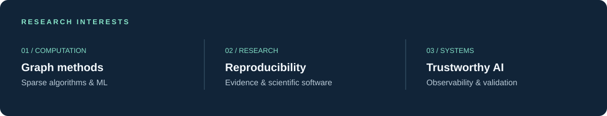
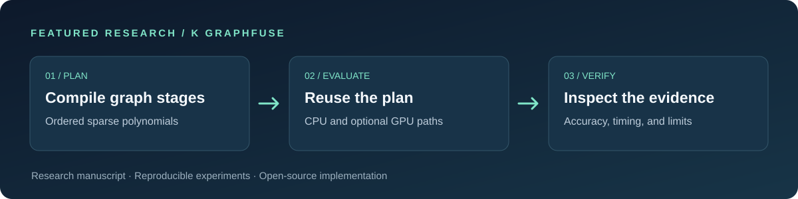

  <strong>BCA graduate (2025) · BS in Data Science student, IIT Madras</strong> 
  Research software · Machine learning · Open source

  <a href="#research-interests">Interests</a> &nbsp;·&nbsp;
  <a href="#featured-research">Research</a> &nbsp;·&nbsp;
  <a href="#open-source">Open source</a> &nbsp;·&nbsp;
  <a href="#selected-projects">Projects</a> &nbsp;·&nbsp;
  <a href="#academic-direction">Academic direction</a>

I am interested in research that connects mathematical ideas with reliable software: making computation measurable, experiments reproducible, and results easier for others to inspect.

## Research interests

## Featured research

### K GraphFuse · Sparse graph computation

K GraphFuse explores sparse graph polynomial evaluation, reusable plans, directional sensitivities, and optional GPU execution. Its accompanying manuscript studies similarity-aware evaluation and selective GPU compensation, with benchmark evidence and reproducibility materials.

[**Repository**](https://github.com/Utkarsh-Sinha0/k-graphfuse) · [**Research manuscript**](https://utkarsh-sinha0.github.io/k-graphfuse/research/paper/) · [PDF](https://github.com/Utkarsh-Sinha0/k-graphfuse/blob/main/docs/research/k-graphfuse-paper.pdf) · [Benchmark evidence](https://utkarsh-sinha0.github.io/k-graphfuse/benchmarks/results/)

*Technical preprint draft; not peer-reviewed. The project documents the scope and limitations of its experimental results.*

## Open source

| Project | Selected contribution | Status |
| :--- | :--- | :--- |
| **OpenTelemetry** | [Browser Fetch client conformance](https://github.com/open-telemetry/semantic-conventions-conformance/pull/162) for the shared HTTP contract | **Merged** |
| **qtop** | [Scheduler error handling](https://github.com/qtop/qtop/pull/510) · [terminal-size fallback and OAR file handling](https://github.com/qtop/qtop/pull/511) | **Merged** |

**In review or development** · OpenTelemetry work as of November 2026

[XMLHttpRequest conformance](https://github.com/open-telemetry/semantic-conventions-conformance/pull/163) · [MCP span classification](https://github.com/open-telemetry/semantic-conventions-conformance/pull/149) · [Entity identity coverage](https://github.com/open-telemetry/semantic-conventions-conformance/pull/346) · [Python GenAI test requirements](https://github.com/open-telemetry/opentelemetry-python-genai/pull/934) · [State-change conventions](https://github.com/open-telemetry/semantic-conventions-genai/pull/483) · [LangGraph instrumentation](https://github.com/open-telemetry/opentelemetry-python-genai/pull/507) *(draft; dependent on the conventions proposal)*

## Selected projects

| Focus | Project | Work |
| :--- | :--- | :--- |
| **Research** | [ReproLearn](https://github.com/Utkarsh-Sinha0/ReproLearn) | Claim-level reproducibility with inspectable research evidence. |
| **Scientific software** | SciBoat *(private repository)* | Rust-backed continuity, reviewed execution, and receiver-attested replay. |
| **Decision support** | [AgentAgri](https://github.com/Utkarsh-Sinha0/AgentAgri) | Agricultural information across crop health, weather, markets, and farmer-owned memory. |
| **Developer tools** | [SNAPV](https://github.com/Utkarsh-Sinha0/SNAPV) | Local-first screenshot exports across Chrome, Firefox, and Edge. |
| **Simulation** | [AXIOM Urban](https://github.com/Utkarsh-Sinha0/AXIOM) | Traffic-corridor analysis using FastAPI and a gRPC simulation engine. |
| **Machine learning** | [NeuroGolf 2026](https://github.com/Utkarsh-Sinha0/NeruraGolf) | Compact ONNX solvers and reproducible visual-transformation experiments. |

## Toolkit

## Academic direction

I am seeking **funded graduate research and scholarship opportunities** in machine learning, data science, and research software. I value rigorous evaluation, open collaboration, and research that others can build upon.

<a href="https://github.com/Utkarsh-Sinha0">Explore my GitHub profile →</a>

