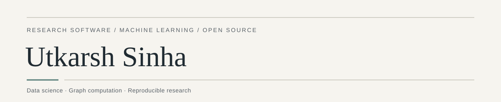

**BS Data Science student, IIT Madras** · BCA graduate, 2025

I am interested in graph computation, machine learning, and the software behind reproducible research. My work connects mathematical ideas to implementations that can be tested, examined, and built upon.

[Research](#research) &nbsp;·&nbsp; [Open source](#open-source) &nbsp;·&nbsp; [Selected projects](#selected-projects) &nbsp;·&nbsp; [Academic direction](#academic-direction)

## Research

### K GraphFuse

**Sparse graph computation · Research software and experimental study**

[K GraphFuse](https://github.com/Utkarsh-Sinha0/k-graphfuse) explores reusable graph-filter plans, directional sensitivities, and optional GPU execution. The accompanying manuscript examines similarity-aware evaluation and selective GPU compensation. The project brings together the implementation, experimental results, and reproducibility materials.

[**Repository**](https://github.com/Utkarsh-Sinha0/k-graphfuse) &nbsp;·&nbsp; [**Manuscript**](https://utkarsh-sinha0.github.io/k-graphfuse/research/paper/) &nbsp;·&nbsp; [PDF](https://github.com/Utkarsh-Sinha0/k-graphfuse/blob/main/docs/research/k-graphfuse-paper.pdf) &nbsp;·&nbsp; [Benchmark evidence](https://utkarsh-sinha0.github.io/k-graphfuse/benchmarks/results/)

Technical preprint draft; not peer-reviewed. Results should be interpreted within the project's documented experimental scope.

View a figure from the controlled experiments

 

Controlled synthetic workloads on two GPUs; resident compute only. Follow the figure for methodology and limitations.

## Open source

My contributions to shared infrastructure include the following merged work:

- **OpenTelemetry:** [Browser Fetch client conformance](https://github.com/open-telemetry/semantic-conventions-conformance/pull/162).
- **qtop:** [Scheduler error handling](https://github.com/qtop/qtop/pull/510) and [terminal-size fallback and OAR file handling](https://github.com/qtop/qtop/pull/511).

Additional OpenTelemetry work in review or development

 

As of November 2026: [XMLHttpRequest conformance](https://github.com/open-telemetry/semantic-conventions-conformance/pull/163) · [MCP span classification](https://github.com/open-telemetry/semantic-conventions-conformance/pull/149) · [Entity identity coverage](https://github.com/open-telemetry/semantic-conventions-conformance/pull/346) · [Python GenAI test requirements](https://github.com/open-telemetry/opentelemetry-python-genai/pull/934) · [State-change conventions](https://github.com/open-telemetry/semantic-conventions-genai/pull/483) · [LangGraph instrumentation](https://github.com/open-telemetry/opentelemetry-python-genai/pull/507) *(draft; dependent on the conventions proposal)*

## Selected projects

**[ReproLearn](https://github.com/Utkarsh-Sinha0/ReproLearn)** — Research reproducibility with inspectable, claim-level evidence.

**[AgentAgri](https://github.com/Utkarsh-Sinha0/AgentAgri)** — Agricultural information spanning crop health, weather, markets, and farmer-owned memory.

**[AXIOM Urban](https://github.com/Utkarsh-Sinha0/AXIOM)** — Traffic-corridor analysis using FastAPI and a gRPC simulation engine.

**[SNAPV](https://github.com/Utkarsh-Sinha0/SNAPV)** — Local-first screenshot exports across Chrome, Firefox, and Edge.

**[NeuroGolf 2026](https://github.com/Utkarsh-Sinha0/NeruraGolf)** — Compact ONNX solvers and reproducible visual-transformation experiments.

**SciBoat** *(private repository)* — Rust-backed continuity, reviewed execution, and receiver-attested replay.

## Academic direction

I am seeking **funded graduate research and scholarship opportunities** in machine learning, data science, and research software. I hope to contribute to work grounded in careful evaluation, open collaboration, and useful, reproducible tools.

Selected tools: Python · TypeScript · Rust · React · FastAPI · Docker · PostgreSQL · ONNX · GitHub Actions
