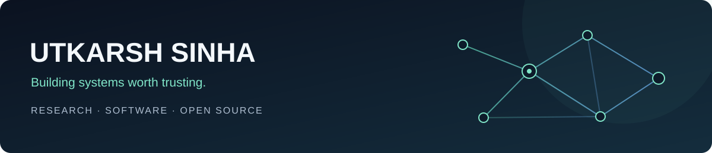

  <strong>Open-source contributor · Responsible disclosure · Research engineering</strong> 
  BCA graduate (2025) · BS in Data Science student at IIT Madras

  <a href="#open-source">Open source</a> &nbsp;·&nbsp;
  <a href="#selected-projects">Projects</a> &nbsp;·&nbsp;
  <a href="#toolkit">Toolkit</a> &nbsp;·&nbsp;
  <a href="#lets-connect">Connect</a>

I build AI systems, research tools, and developer products with an emphasis on clear contracts, practical validation, and evidence others can inspect.

## Open source

| Project | Contribution | Status |
| --- | --- | --- |
| **OpenTelemetry** | [Browser Fetch client conformance](https://github.com/open-telemetry/semantic-conventions-conformance/pull/162) for the shared HTTP contract | **Merged** |
| **qtop** | [Scheduler error handling](https://github.com/qtop/qtop/pull/510) and [terminal-size fallback and OAR file handling](https://github.com/qtop/qtop/pull/511) | **Merged** |

**Open work** · OpenTelemetry contributions in review or development as of November 2026:

- **Conformance:** [XMLHttpRequest](https://github.com/open-telemetry/semantic-conventions-conformance/pull/163) · [MCP span classification](https://github.com/open-telemetry/semantic-conventions-conformance/pull/149) · [entity identity coverage](https://github.com/open-telemetry/semantic-conventions-conformance/pull/346)
- **GenAI:** [Python test requirements](https://github.com/open-telemetry/opentelemetry-python-genai/pull/934) · [state-change conventions](https://github.com/open-telemetry/semantic-conventions-genai/pull/483) · [LangGraph instrumentation](https://github.com/open-telemetry/opentelemetry-python-genai/pull/507) *(draft; depends on the conventions proposal)*

## Selected projects

| Project | What it explores |
| --- | --- |
| [**ReproLearn**](https://github.com/Utkarsh-Sinha0/ReproLearn) | Claim-level research reproducibility, with papers, code, data, and validation evidence. |
| [**SciBoat**](https://github.com/Utkarsh-Sinha0/SciBoat) | Rust-backed scientific continuity, reviewed execution, and receiver-attested replay. |
| [**AgentAgri**](https://github.com/Utkarsh-Sinha0/AgentAgri) | Agricultural decision support across crop health, weather, markets, schemes, finance, and farmer-owned memory. |
| [**SNAPV**](https://github.com/Utkarsh-Sinha0/SNAPV) | Local-first screenshot exports for Chrome, Firefox, and Edge. |
| [**AXIOM Urban**](https://github.com/Utkarsh-Sinha0/AXIOM) | Traffic-corridor analysis with FastAPI workflows and a gRPC simulation engine. |
| [**NeuroGolf 2026**](https://github.com/Utkarsh-Sinha0/NeruraGolf) | Compact ONNX solvers and reproducible experiments for ARC-AGI-style visual transformations. |

## Toolkit

`Python`  `TypeScript`  `Rust`  `React`  `FastAPI`  `Docker`  `PostgreSQL`  `ONNX`  `GitHub Actions`

I work across APIs, browser flows, accessibility, containers, and CI. My approach is evidence-first: point claims to code and tests, state gaps clearly, and make public work easy to inspect and extend.

## Let's connect

I'm interested in research engineering, developer tools, applied AI, and data science—and collaborations with students, researchers, and open-source maintainers.

<a href="https://github.com/Utkarsh-Sinha0">Explore my GitHub profile →</a>

